**Front publicado:** pendiente.

El front de TrustTix está en la carpeta `frontend/` del repositorio. Es una aplicación web hecha con React y Vite, pensada primero para celular (mobile first) y adaptable a tablet y escritorio. Implementa de punta a punta el flujo principal del MVP definido en el Product Blueprint: crear un evento con capacidad máxima, comprar un boleto, verlo con su código QR, transferirlo, verificarlo antes de comprarlo en reventa y registrarlo en la puerta del evento.

### Cómo está construido

| Aspecto | Decisión |
| --- | --- |
| Tecnología | React 19, Vite y React Router. El código QR se genera con la librería `qrcode.react`. |
| Diseño | Tema oscuro basado en los bocetos del equipo. Tipografías Golos Text para títulos y Roboto para textos. |
| Responsive | En celular la navegación es una barra inferior y el contenido va en una columna. Desde 640 px las tarjetas se acomodan en dos columnas y desde 960 px la navegación pasa a una barra lateral y el detalle del evento se divide en dos columnas. |
| Datos | Esta semana el front funciona con datos de ejemplo guardados en el navegador. Cada acción ya aplica las mismas reglas que tendrá el contrato, para que la próxima semana solo haya que conectarla a la red. |

Toda la lógica que después vivirá en Stellar está concentrada en un solo archivo (`frontend/src/context/AppContext.jsx`). Cada función de ese archivo corresponde a una función del contrato descrito en el Blueprint: `crearEvento`, `comprar`, `transferir`, `consultarBoleto` y `registrarEntrada`. Las pantallas no saben si los datos vienen del navegador o de la red, así que el cambio de la próxima semana no las afecta.

### Pantallas implementadas y su relación con el MVP

| # | Pantalla | Qué hace | Historia del backlog |
| :---: | --- | --- | :---: |
| 1 | Inicio de sesión | Entrada a la app con el lema "Tu acceso al mundo". El acceso con Google es simulado. | |
| 2 | Inicio | Lista de eventos con buscador y filtros por categoría. Cada tarjeta muestra lugares vendidos frente a la capacidad, precio y el estado del botón (Ver evento, Asistiré o Agotado). | P1 |
| 3 | Detalle del evento | Imagen, descripción, ubicación con mapa, fecha, organizador verificado, barra de lugares, sello de capacidad protegida y la compra. | P1, P2, P4 |
| 4 | Confirmar compra | Hoja que simula la firma en la billetera: evento, total en USDC, cuenta de origen y red. | P2, P3, P4 |
| 5 | Detalle del boleto | Boleto con su código QR, número, fecha, estado y el registro de movimientos. | P9 |
| 6 | Mis boletos | Los boletos que pertenecen a la billetera conectada. | P9 |
| 7 | Transferir | Envía el boleto a otra dirección Stellar. Solo el dueño puede hacerlo y un boleto usado no se puede transferir. | P7 |
| 8 | Verificar | Página pública, sin sesión ni billetera, para revisar dueño, estado e historial de un boleto antes de comprarlo en reventa. | P8 |
| 9 y 10 | Escáner de acceso | El personal elige el evento, escanea el boleto y ve verde si es válido o rojo si ya se usó, no existe o es de otro evento. Al registrar la entrada, el boleto queda marcado como usado. | P5, P6 |
| 11 | Crear evento | Formulario del organizador con capacidad máxima, que el contrato no permitirá rebasar. | P1 |
| 12 | Perfil | Billetera conectada, acceso al panel del organizador y a la app de acceso. | P3 |

### Recorrido por las pantallas

**1. Inicio de sesión e inicio.** La persona entra y ve los eventos principales. La barra de cada tarjeta muestra cuántos lugares quedan, que es el dato que el contrato garantiza. Cuando quedan pocos aparece la etiqueta "Quedan 12" y cuando se acaban el botón cambia a "Agotado".

| Inicio de sesión | Inicio |
| :---: | :---: |
| 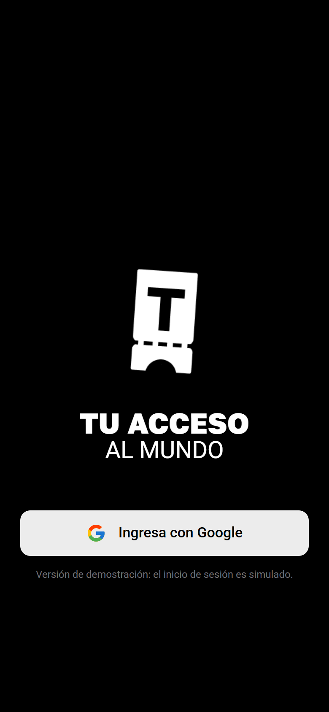 | 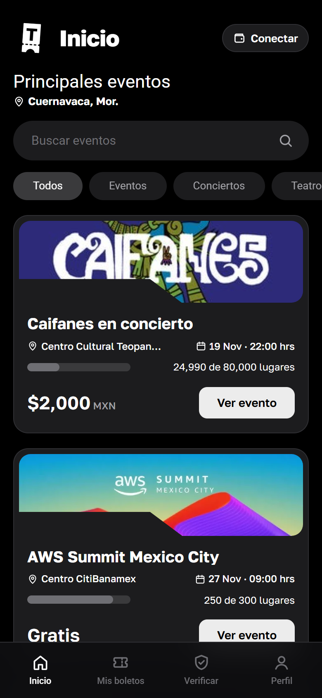 |

**2. Detalle del evento y compra.** El detalle reúne toda la información para decidir. El sello de capacidad protegida explica al usuario, sin tecnicismos, que el evento no puede vender más boletos que su capacidad. Al comprar, la app pide firmar en la billetera; el pago y la emisión del boleto ocurren en una sola operación.

| Detalle del evento | Confirmar compra |
| :---: | :---: |
| 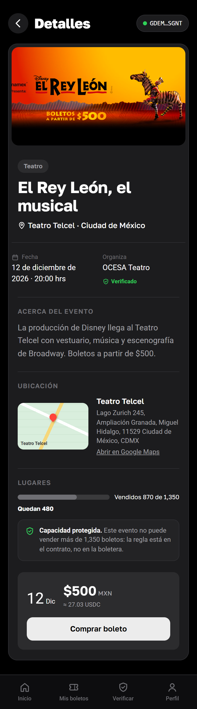 | 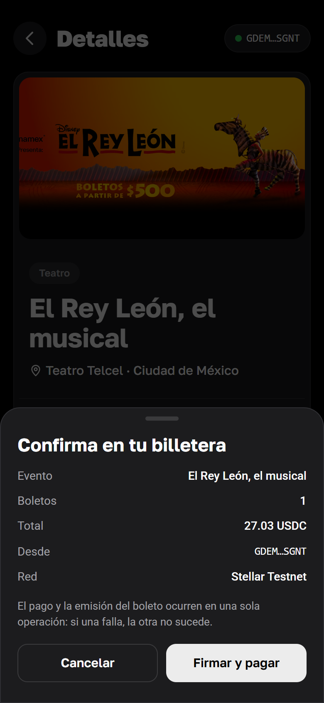 |

**3. Boleto y mis boletos.** El boleto conserva la forma de boleto físico del diseño, con el QR que se presenta en la puerta y el registro de cada movimiento. "Mis boletos" muestra solo los que pertenecen a la billetera conectada.

| Detalle del boleto | Mis boletos |
| :---: | :---: |
| 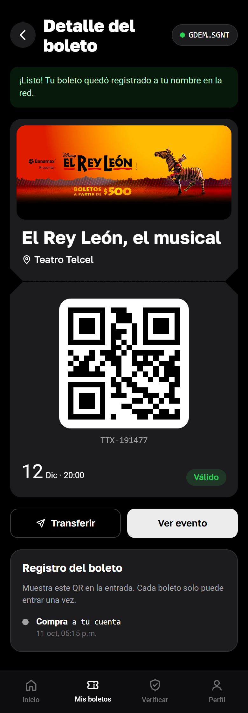 | 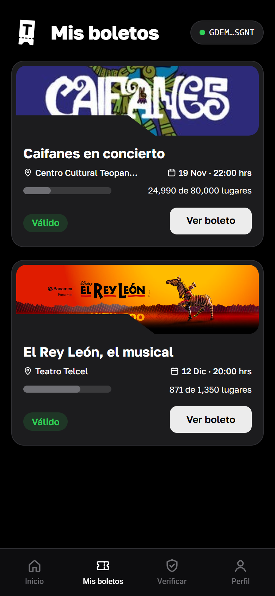 |

**4. Transferir y verificar.** La transferencia mueve el boleto a otra cuenta en el mismo registro, así que nunca existen dos dueños al mismo tiempo. La verificación es pública: cualquiera que vaya a comprar en reventa puede confirmar quién es el dueño y si el boleto ya se usó.

| Transferir | Verificar |
| :---: | :---: |
| 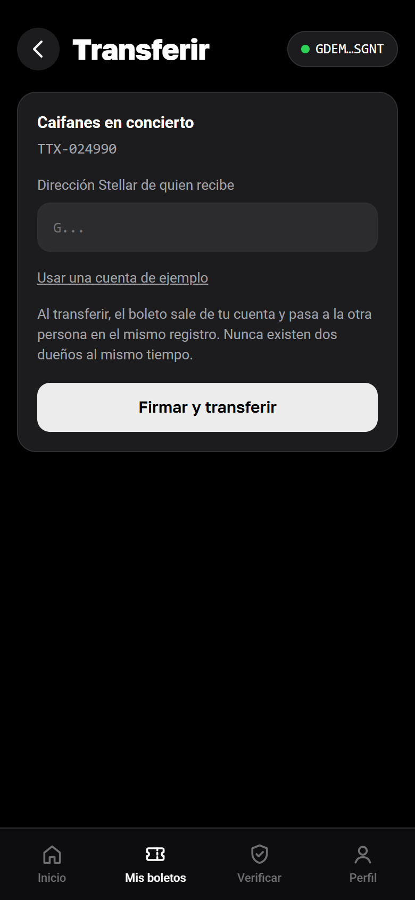 | 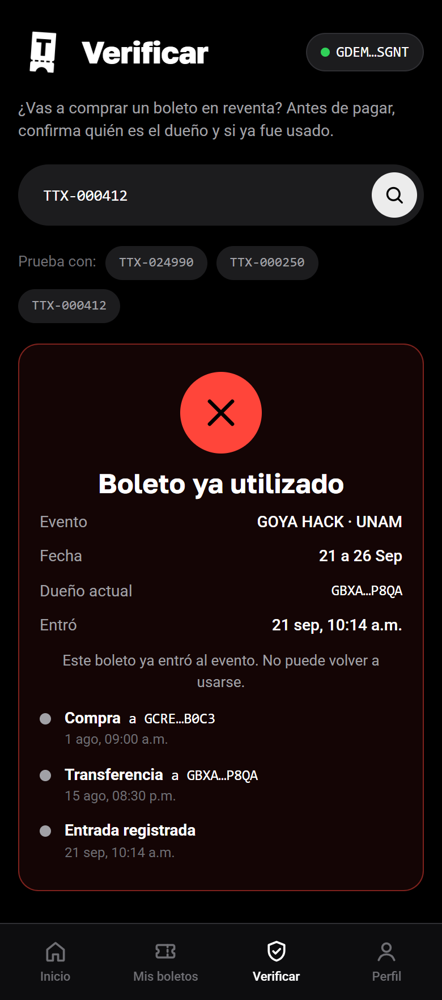 |

**5. Acceso en la puerta.** El personal escanea el boleto. Si es válido, registra la entrada; si alguien intenta entrar otra vez con el mismo boleto, el sistema lo rechaza y muestra la hora en que ya entró.

| Boleto válido | Boleto ya utilizado |
| :---: | :---: |
| 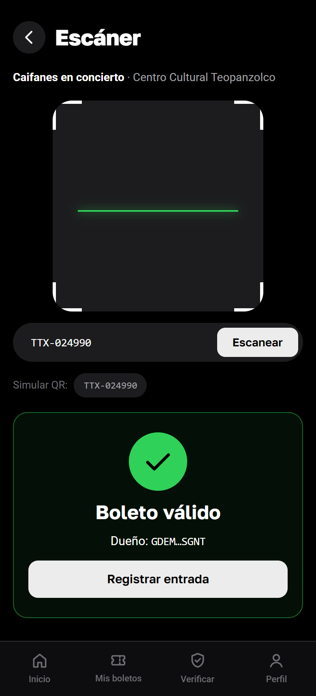 | 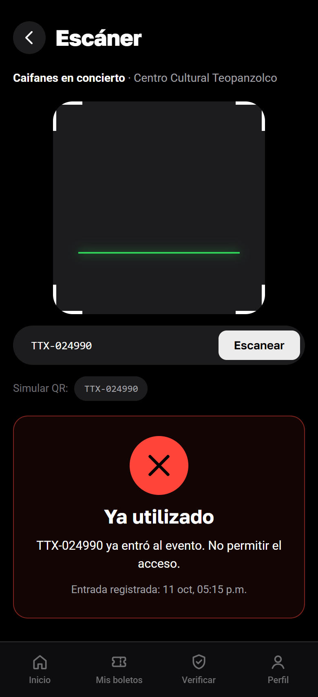 |

**6. Organizador y perfil.** El organizador crea eventos indicando la capacidad máxima. Desde el perfil se administra la billetera y se entra al panel del organizador y a la app de acceso.

| Crear evento | Perfil |
| :---: | :---: |
| 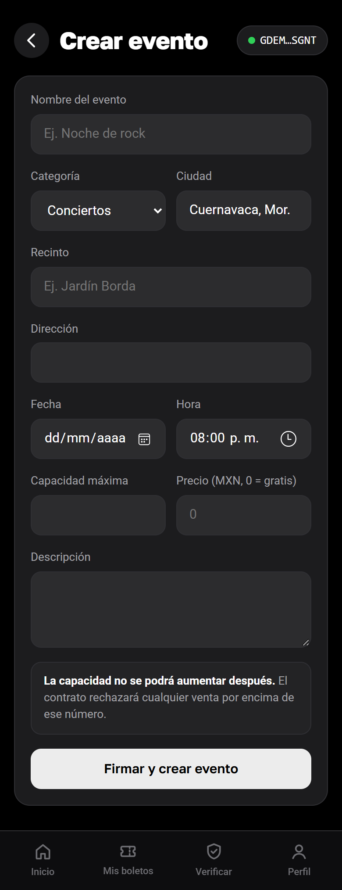 | 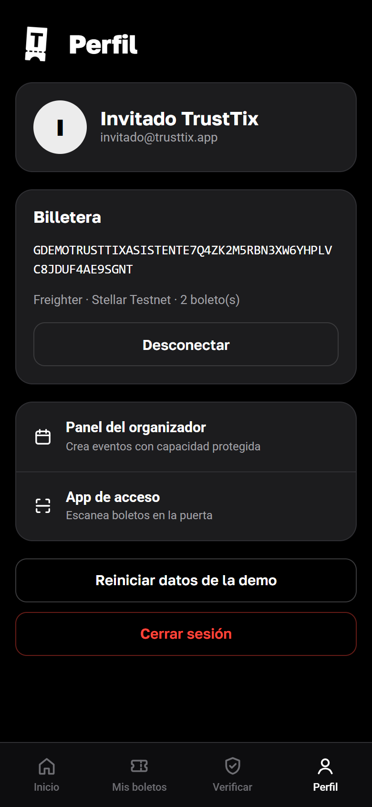 |

**7. Versión de escritorio.** En pantallas grandes la navegación pasa a una barra lateral, los eventos se muestran en tres columnas y el detalle se divide en dos.

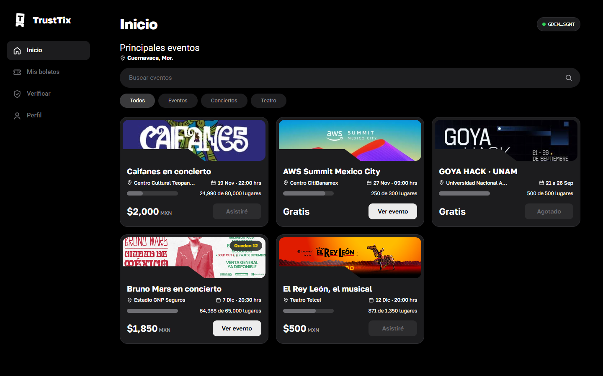

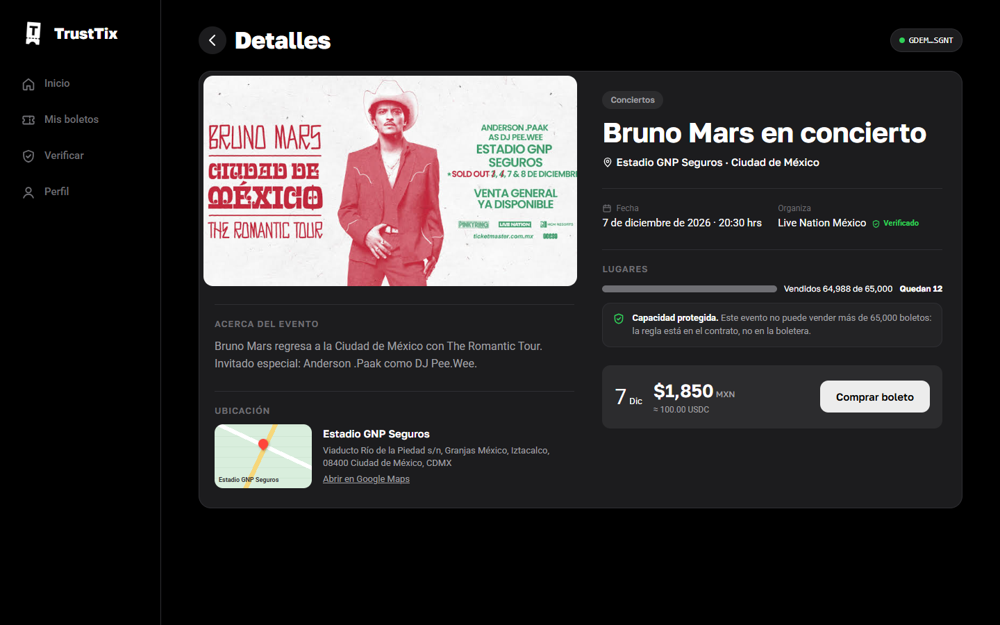

### Qué está simulado en esta entrega

- **Inicio de sesión con Google:** no usa una cuenta real.
- **Billetera Freighter:** al conectar se usa una cuenta de ejemplo de Stellar Testnet.
- **Escaneo con cámara:** en la app de acceso se escribe o se elige el número de boleto en lugar de leer el QR con la cámara.
- **Datos:** los eventos y boletos viven en el navegador. El botón "Reiniciar datos de la demo" del perfil los regresa a su estado inicial.

Aunque estas piezas están simuladas, las reglas del producto ya funcionan en el front: no se puede comprar si no quedan lugares, solo el dueño puede transferir y un boleto no puede entrar dos veces.
